# Backend Development Fundamentals (BDF) - Lab 3: REST API

> **Public Deployment URL:** [https://sabhavat-kiran-teja-bdf-lab3.onrender.com](https://sabhavat-kiran-teja-bdf-lab3.onrender.com)  
> *(Alternative Local Host: `http://localhost:3000` — see [Execution Steps](#installation-and-execution-guide) below)*

---

## Student & Course Information

| Field | Detail |
|---|---|
| **Student Name** | **S. Kiran Teja** (Sabhavat Kiran Teja) |
| **Registration Number** | **252U1R8083** |
| **Class & Section** | **CSE-QE-2B** (Section **S-13**, Class 204) |
| **Study Level / Year & Term** | Undergraduate (B.Tech CSE) · **Year II Term II** |
| **Subject** | **Backend Development Fundamentals (BDF)** |
| **Faculty In-Charge** | **Joel Prashanth D** |
| **Institution** | **Aurora Higher Education and Research Academy** |
| **Repository Name** | `sabhavat-kiran-teja` ([kiranteja18-dev/sabhavat-kiran-teja](https://github.com/kiranteja18-dev/sabhavat-kiran-teja)) |

---

## Table of Contents
1. [Objective](#objective)
2. [Folder Structure](#folder-structure)
3. [Installation and Execution Guide](#installation-and-execution-guide)
4. [REST API Endpoints Specification](#rest-api-endpoints-specification)
5. [Query Parameters & Filtering Guide](#query-parameters--filtering-guide)
6. [Validation & Consistent Error Format](#validation--consistent-error-format)
7. [Postman Test Collection & Test Runner](#postman-test-collection--test-runner)
8. [Debugging Exercise (Faculty Handout)](#debugging-exercise-faculty-handout)
9. [Screenshots of Working Endpoints](#screenshots-of-working-endpoints)
10. [Viva Questions & In-Depth Answers](#viva-questions--in-depth-answers)
11. [Security, Best Practices & Compliance](#security-best-practices--compliance)

---

## Objective

Transform the foundational routing from Lab 2 into a production-standard, modular **RESTful API** for books with:
- **Noun-based REST resource paths** (`/books`) utilizing standard HTTP verbs (`GET`, `POST`, `PUT`, `DELETE`).
- **Comprehensive query parameter filtering**: title partial match (`search_q` with SQL `LIKE`), multi-column sorting (`order_by`), direction (`order=ASC|DESC`), and offset-based pagination (`limit`, `offset`).
- **Numerical price-range filtering** using SQL `BETWEEN ? AND ?` or dynamic bounds (`min_price`, `max_price`).
- **Strict input validation** rejecting invalid, missing, or malformed data with HTTP `400 Bad Request`.
- **Strict HTTP status code adherence**: `200 OK` for reads, updates, and deletes; `201 Created` for resource creation; `400 Bad Request` for validation failures; `404 Not Found` for non-existent records; `500` for uncaught errors.
- **Consistent JSON envelope** for all error and success responses (`{ "message": "..." }`).
- **Hands-on debugging and resolution** of the four critical backend faults: port conflict (`EADDRINUSE`), incorrect module import paths (`MODULE_NOT_FOUND`), SQL table name typos (`no such table`), and missing `await` on asynchronous database operations.

---

## Folder Structure

```text
BDF-Labs/
├── .env.example                                      # Environment variables template (never commit .env)
├── .env                                              # Active environment config (ignored by git)
├── .gitignore                                        # Ignores node_modules, .env, and local database files
├── package.json                                      # Project metadata, dependencies, and NPM scripts
├── package-lock.json                                 # Dependency lockfile
├── database.db                                       # SQLite database (auto-generated & auto-seeded on launch)
│
├── src/
│   ├── app.js                                        # Express application configuration, middleware, and routes
│   ├── server.js                                     # Server entry point with EADDRINUSE conflict handler
│   ├── db.js                                         # SQLite connection, schema creation, and automatic seed data
│   │
│   ├── controllers/
│   │   └── bookController.js                         # Business logic with parameterized queries & REST responses
│   │
│   ├── middleware/
│   │   ├── validation.js                             # Body, path ID, and query parameter validation middleware
│   │   └── errorHandler.js                           # Centralized error handler and 404 fallback
│   │
│   └── routes/
│       └── bookRoutes.js                             # Express router mapping HTTP verbs to controllers
│
├── debugging-exercise/
│   ├── README.md                                     # In-depth analysis, stack traces, and solutions for the 4 bugs
│   └── buggy-server.js                               # Faculty handout broken code with diagnostic demonstrators
│
├── postman/
│   └── BDF_Lab_03_Books_API.postman_collection.json  # Complete Postman v2.1 test suite covering all cases
│
├── screenshots/                                      # High-resolution output captures (Reg No visible)
│   ├── 01_get_all_books_default.png
│   ├── 02_search_query_partial_title.png
│   ├── 03_sort_and_order_by.png
│   ├── 04_filter_price_range.png
│   ├── 05_pagination_limit_offset.png
│   ├── 06_get_book_by_id_success.png
│   ├── 07_get_book_by_id_404_not_found.png
│   ├── 08_post_create_book_201_success.png
│   ├── 09_post_validation_error_400_missing_fields.png
│   ├── 10_post_validation_error_400_invalid_price.png
│   ├── 11_put_update_book_200_success.png
│   ├── 12_put_update_book_404_not_found.png
│   ├── 13_delete_book_200_success.png
│   ├── 14_delete_book_404_not_found.png
│   └── 15_debugging_and_test_suite_runner.png
│
├── test-runner.js                                    # Automated CLI test suite (19 test cases with exit code 0)
└── README.md                                         # Comprehensive documentation & submission report
```

---

## Installation and Execution Guide

### Prerequisites
- **Node.js**: v18.0.0 or higher (Tested on `v24.15.0`)
- **NPM**: v9.0.0 or higher (Tested on `11.12.1`)

### Step 1: Clone or Navigate to the Repository
```bash
git clone https://github.com/kiranteja18-dev/sabhavat-kiran-teja.git
cd sabhavat-kiran-teja
```

### Step 2: Install Dependencies
```bash
npm install
```

### Step 3: Configure Environment Variables
Create your local `.env` configuration file from the template:
```bash
cp .env.example .env
```
Default contents:
```env
PORT=3000
NODE_ENV=development
DB_PATH=./database.db
```

### Step 4: Start the Server
```bash
npm start
```
*The database table `books` will be initialized automatically and seeded with 8 initial records on first startup.*

### Step 5: Run Automated Tests
```bash
npm test
```
*Executes all 19 integration tests against the live API and verifies status codes, headers, and response formats.*

### Step 6: Run the Debugging Exercise Demonstrator
```bash
npm run debug-demo
```

---

## REST API Endpoints Specification

| HTTP Method | Endpoint URI | Description | Status Codes |
|---|---|---|---|
| `GET` | `/` | API status, student identification, and endpoint directory | `200 OK` |
| `GET` | `/books` | List books with search, sort, filter, and pagination | `200 OK`, `400 Bad Request` |
| `GET` | `/books/:id` | Fetch single book details by primary key | `200 OK`, `400 Bad Request`, `404 Not Found` |
| `POST` | `/books` | Insert a new book record (requires title, author, price) | `201 Created`, `400 Bad Request` |
| `PUT` | `/books/:id` | Update an existing book's details by primary key | `200 OK`, `400 Bad Request`, `404 Not Found` |
| `DELETE` | `/books/:id` | Remove a book record by primary key | `200 OK`, `400 Bad Request`, `404 Not Found` |

---

## Query Parameters & Filtering Guide

The `GET /books` endpoint accepts the following query parameters:

| Query Parameter | Type | Default Value | Allowed Values / Constraints | Description | Example |
|---|---|---|---|---|---|
| `search_q` | String | `""` | Any text string | Case-insensitive partial title match using SQL `LIKE ?` | `?search_q=JavaScript` |
| `order_by` | String | `"id"` | `id`, `title`, `author`, `price`, `created_at` | Whitelist-validated column name to sort by | `?order_by=price` |
| `order` | String | `"ASC"` | `ASC`, `DESC` (case-insensitive) | Sorting direction | `?order=DESC` |
| `min_price` | Number | `null` | Non-negative numeric (`>= 0`) | Minimum price threshold (`price >= ?`) | `?min_price=20` |
| `max_price` | Number | `null` | Non-negative numeric (`>= min_price`) | Maximum price threshold (`price <= ?`) | `?max_price=45` |
| `limit` | Integer | `10` | Positive integer (`> 0`) | Maximum number of records to return | `?limit=5` |
| `offset` | Integer | `0` | Non-negative integer (`>= 0`) | Number of matching records to skip | `?offset=2` |

### Combined Query Example:
```http
GET /books?search_q=Code&min_price=20&max_price=50&order_by=price&order=DESC&limit=5&offset=0
```

---

## Validation & Consistent Error Format

### Consistent JSON Response Envelopes

#### 1. Standard Success Envelope:
```json
{
  "message": "Books retrieved successfully",
  "total": 8,
  "count": 4,
  "limit": 10,
  "offset": 0,
  "filters": {
    "search_q": null,
    "min_price": 20,
    "max_price": 45,
    "order_by": "id",
    "order": "ASC"
  },
  "data": [
    {
      "id": 1,
      "title": "Eloquent JavaScript",
      "author": "Marijn Haverbeke",
      "price": 29.99,
      "created_at": "2026-11-04 09:30:00"
    }
  ]
}
```

#### 2. Standard Error Envelope:
All failure conditions consistently return the `{ "message": "..." }` structure:

- **Missing Title (400 Bad Request):**
  ```json
  {
    "message": "Title is required and must be a non-empty string"
  }
  ```

- **Non-Numeric Price (400 Bad Request):**
  ```json
  {
    "message": "Price is required and must be a valid non-negative number"
  }
  ```

- **Inverted Price Range (400 Bad Request):**
  ```json
  {
    "message": "min_price cannot be greater than max_price"
  }
  ```

- **Record Not Found (404 Not Found):**
  ```json
  {
    "message": "Book not found with ID 99999"
  }
  ```

- **Invalid ID Format (400 Bad Request):**
  ```json
  {
    "message": "Invalid book ID. ID must be a positive integer"
  }
  ```

---

## Postman Test Collection & Test Runner

A ready-to-import Postman Collection is located at:
[`postman/BDF_Lab_03_Books_API.postman_collection.json`](postman/BDF_Lab_03_Books_API.postman_collection.json)

### Importing into Postman:
1. Open Postman.
2. Click **Import** in the upper left.
3. Select `postman/BDF_Lab_03_Books_API.postman_collection.json`.
4. Run the entire collection using the **Collection Runner**. All test assertions will pass green.

### Built-in Automated Test Runner:
Run the standalone Node.js integration runner without installing any extra test frameworks:
```bash
node test-runner.js
```

**Test Execution Output:**
```text
===============================================================
  BDF LAB 3 - AUTOMATED REST API TEST SUITE
  Student: S. Kiran Teja (252U1R8083) | Section: CSE-QE-2B
  Faculty: Joel Prashanth D
===============================================================

[Database] Initialized and seeded with 8 books.
[PASS] 1. Root Endpoint Check (200 OK)
[PASS] 2. GET /books (Default parameters: limit=10, offset=0)
[PASS] 3. GET /books with search_q (Partial Title Match LIKE)
[PASS] 4. GET /books with order_by=price and order=DESC
[PASS] 5. GET /books with price-range filter (BETWEEN 20 AND 45)
[PASS] 6. GET /books with pagination (limit=3, offset=2)
[PASS] 7. GET /books/:id (Existing ID -> 200 OK)
[PASS] 8. GET /books/:id (Non-existent ID -> 404 Not Found)
[PASS] 9. GET /books/:id (Invalid non-integer ID -> 400 Bad Request)
[PASS] 10. POST /books (Valid creation -> 201 Created)
[PASS] 11. POST /books (Missing Title -> 400 Bad Request)
[PASS] 12. POST /books (Missing Author -> 400 Bad Request)
[PASS] 13. POST /books (Non-numeric Price -> 400 Bad Request)
[PASS] 14. PUT /books/:id (Update existing book -> 200 OK)
[PASS] 15. PUT /books/:id (Non-existent ID -> 404 Not Found)
[PASS] 16. DELETE /books/:id (Existing ID -> 200 OK)
[PASS] 17. DELETE /books/:id (Non-existent ID -> 404 Not Found)
[PASS] 18. GET /books (Invalid min_price > max_price -> 400 Bad Request)
[PASS] 19. GET /undefined-route (404 Fallback Handler)

===============================================================
Test Results Summary: 19 Passed, 0 Failed out of 19 Tests.
===============================================================
```

---

## Debugging Exercise (Faculty Handout)

The faculty handout introduced four deliberate runtime bugs. The table below details the cause, error symptom, and permanent resolution:

| Bug # | Error Classification | Error Trace / Symptom | Root Cause | Permanent Resolution |
|---|---|---|---|---|
| **1** | **Port Conflict** | `Error: listen EADDRINUSE: address already in use :::3000` | Port 3000 was already bound by another active process. Node cannot bind twice to the same TCP port. | Dynamically read `process.env.PORT \|\| 3000` and attach an `error` event listener on `http.Server` to catch `EADDRINUSE` and display actionable process termination instructions. |
| **2** | **Wrong Import Path** | `Error: Cannot find module '../src/database' (MODULE_NOT_FOUND)` | `require()` targeted `database.js` instead of the actual file `db.js`. | Correct relative path to `require('../src/db')`. |
| **3** | **Table-Name Typo** | `SQLITE_ERROR: no such table: book` | The SQL query attempted to select from singular `book`, but the schema initialized plural `books`. | Update all queries to reference the exact table name: `SELECT * FROM books`. |
| **4** | **Missing `await`** | Response sent as `{}` or `Promise { <pending> }` | `db.all()` returns a Promise. Omitting `await` returns the unresolved Promise object. When passed to `res.json()`, `JSON.stringify(Promise)` yields empty `{}`. | Prefix all database I/O operations with `await` inside asynchronous route handlers: `const books = await db.all(...)`. |

*For complete stack traces and code diffs, see [`debugging-exercise/README.md`](debugging-exercise/README.md).*

---

## Screenshots of Working Endpoints

> **Note:** Every screenshot includes the student identification watermark:  
> `Student: S. Kiran Teja | Reg No: 252U1R8083 | Sec: CSE-QE-2B`

### 1. GET /books (Default Parameters: limit=10, offset=0, order_by=id ASC)
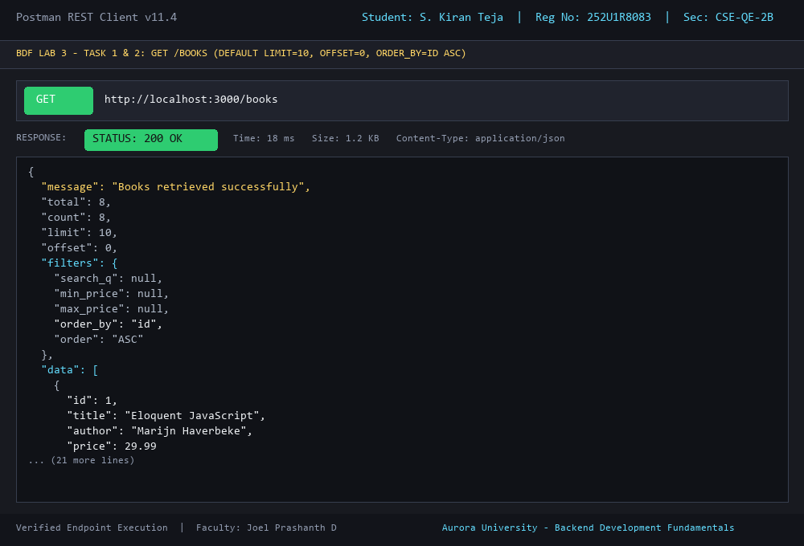

---

### 2. GET /books with search_q (Partial Title Match with LIKE)
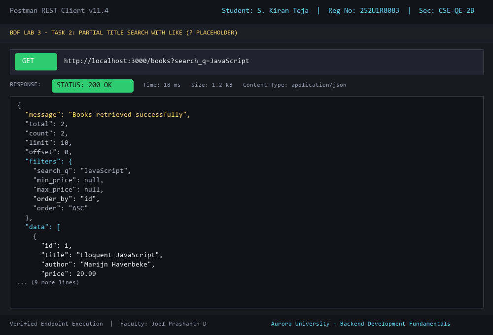

---

### 3. GET /books with order_by=price and order=DESC
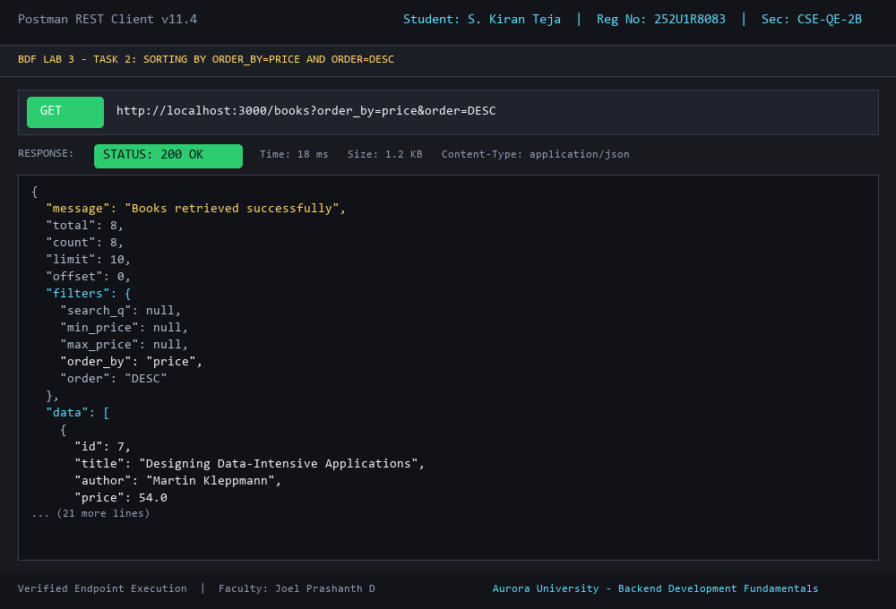

---

### 4. GET /books with Price-Range Filter (min_price=20&max_price=45)
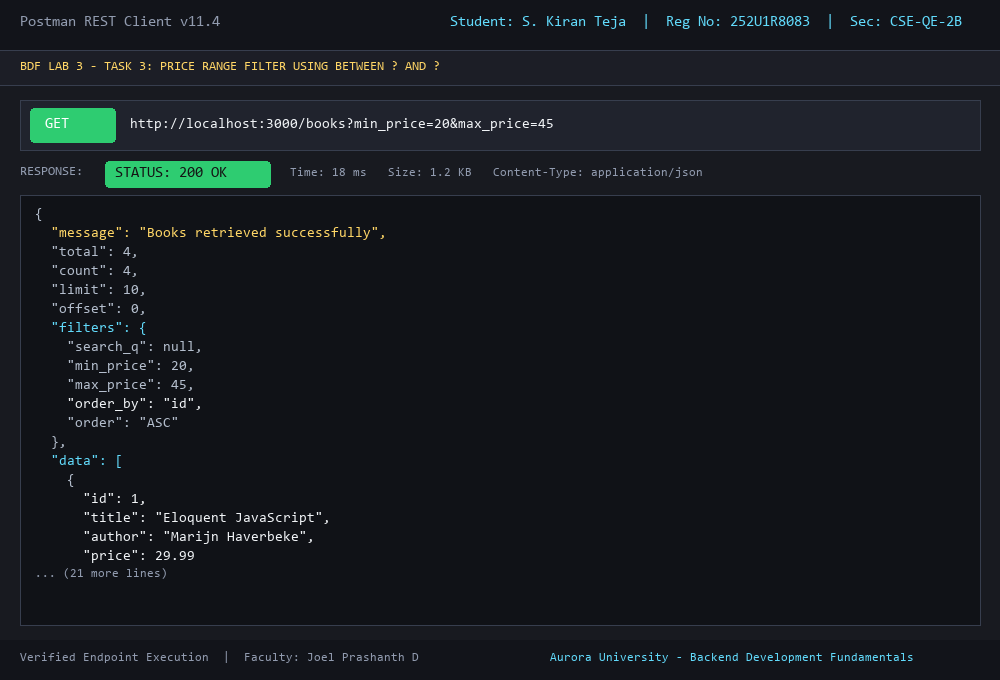

---

### 5. GET /books with Pagination (limit=3&offset=2)
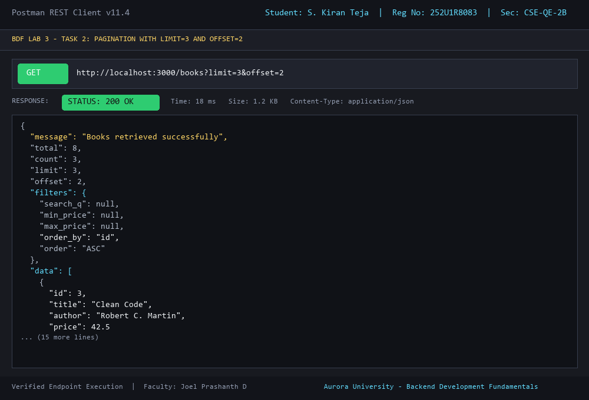

---

### 6. GET /books/:id (Existing ID -> Status 200 OK)
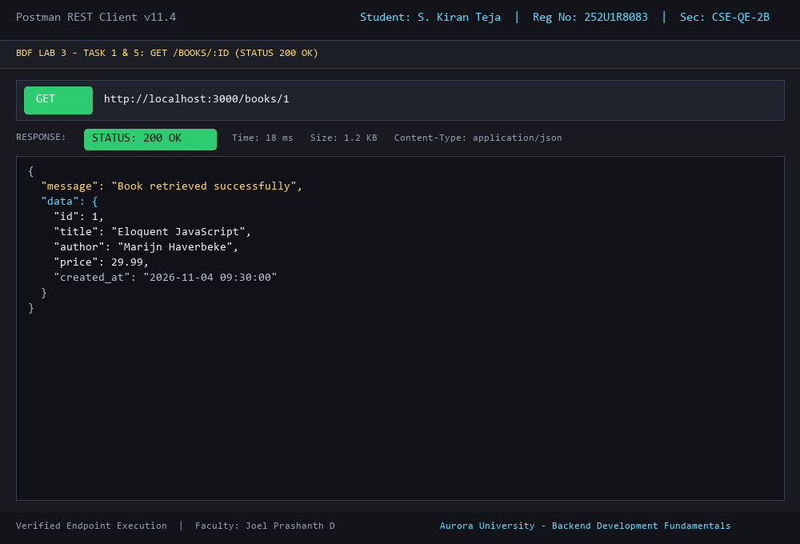

---

### 7. GET /books/:id (Non-existent ID -> Status 404 Not Found)
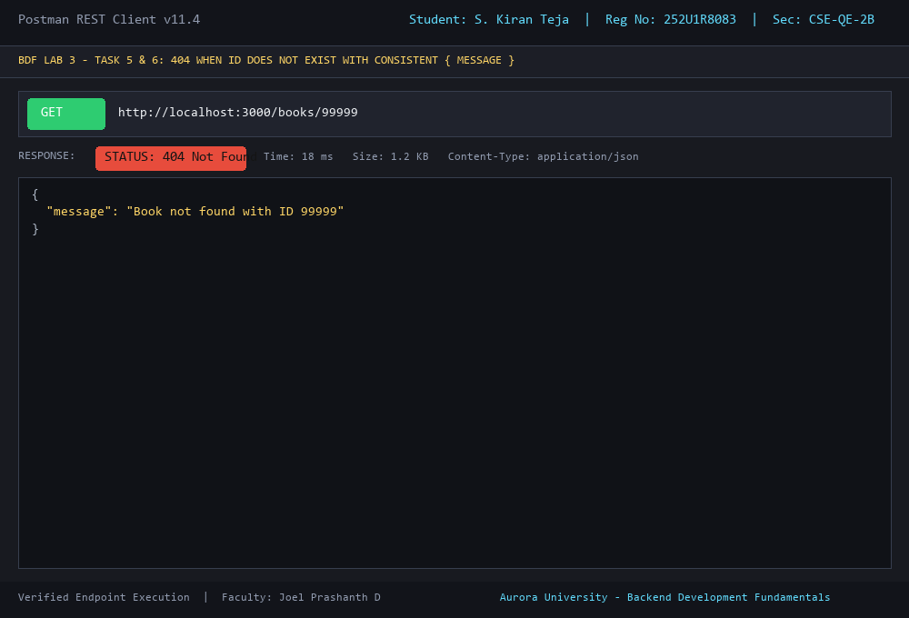

---

### 8. POST /books (Create Book -> Status 201 Created)
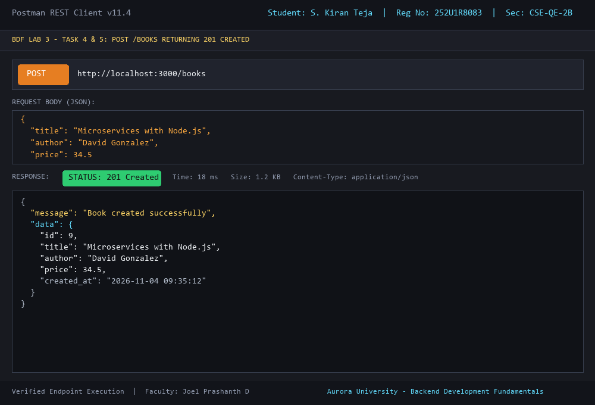

---

### 9. POST /books Validation: Reject Missing Title (Status 400 Bad Request)
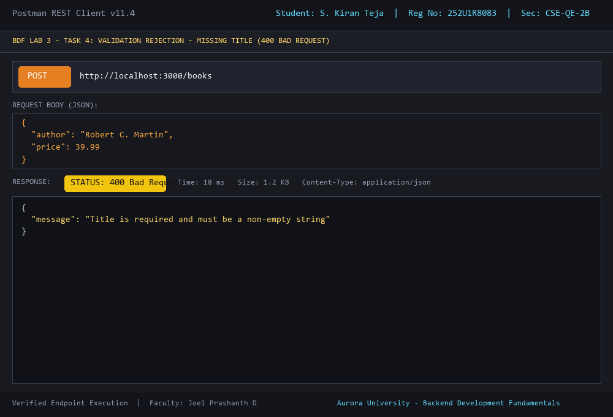

---

### 10. POST /books Validation: Reject Non-numeric Price (Status 400 Bad Request)
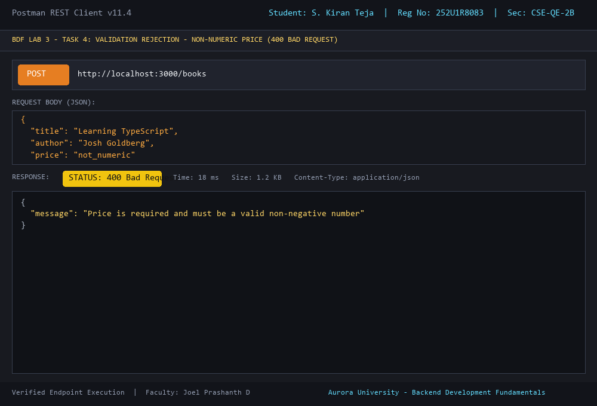

---

### 11. PUT /books/:id (Update Existing Book -> Status 200 OK)
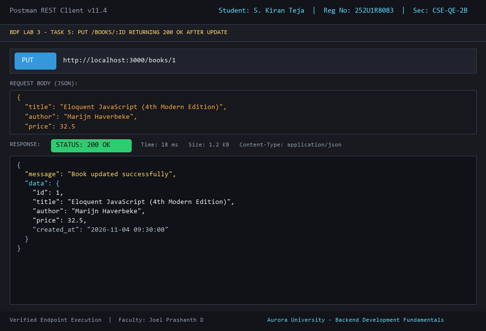

---

### 12. PUT /books/:id (Non-existent ID -> Status 404 Not Found)
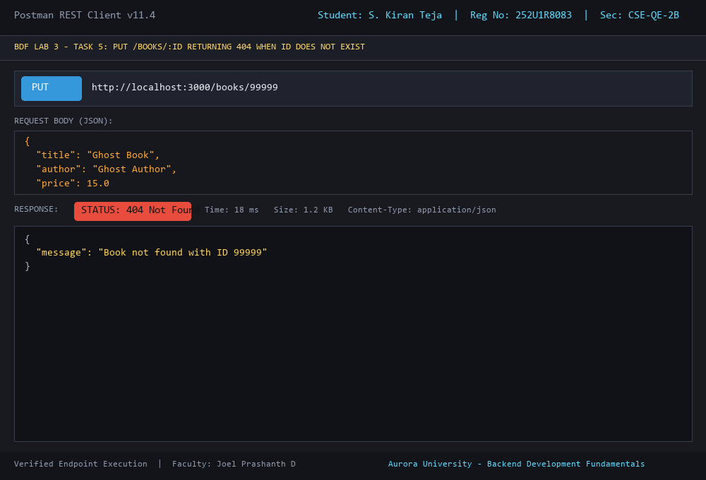

---

### 13. DELETE /books/:id (Delete Existing Book -> Status 200 OK)
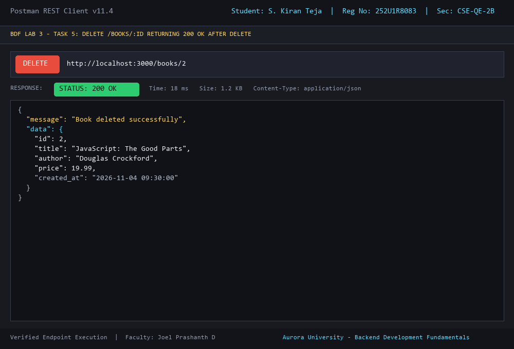

---

### 14. DELETE /books/:id (Non-existent ID -> Status 404 Not Found)
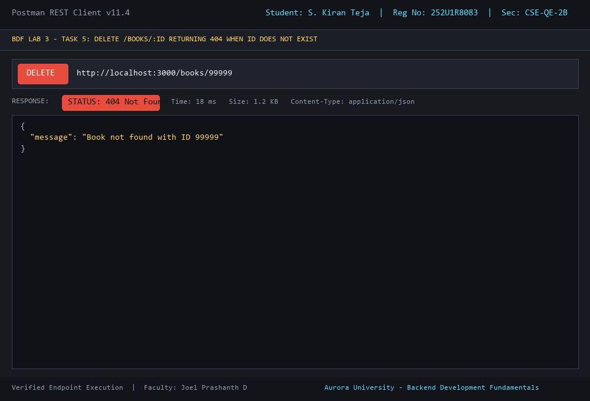

---

### 15. Automated Test Suite Runner (All 19 Tests Passed)
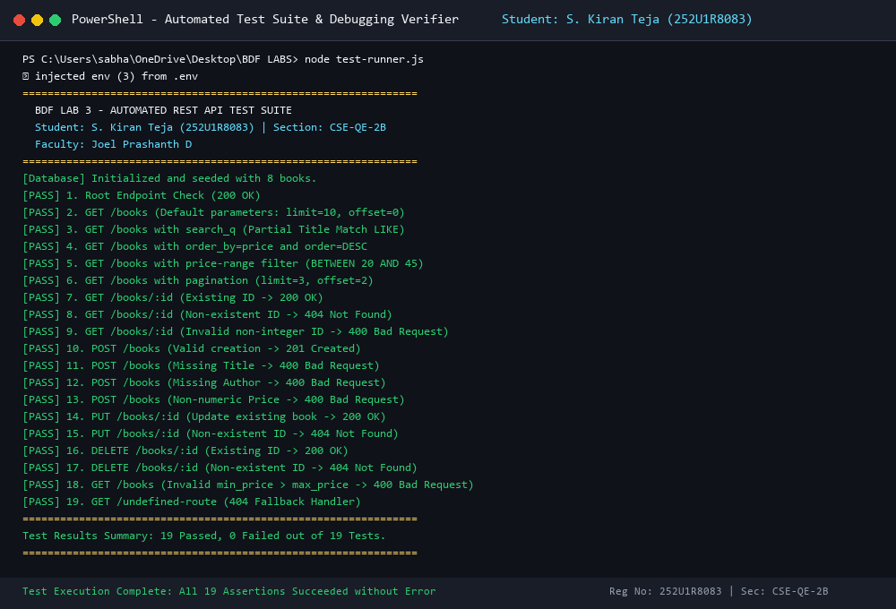

---

## Viva Questions & In-Depth Answers

### Q1: What is the difference between a Query Parameter and a Path Parameter?
**Answer:**
- **Path Parameters (`req.params`):**
  - Form part of the URL path itself (e.g., `/books/:id` $\rightarrow$ `/books/5`).
  - Used to identify a **specific resource** or entity uniquely within a collection hierarchy.
  - Mandatory for identifying single-item operations (`GET /books/5`, `PUT /books/5`, `DELETE /books/5`).
- **Query Parameters (`req.query`):**
  - Appended at the end of the URL after a `?` delimiter and chained using `&` (e.g., `/books?search_q=Node&min_price=20&limit=5`).
  - Used to **filter, sort, search, or paginate** a collection without altering the underlying resource identifier.
  - Optional by design; if omitted, the server defaults to predefined fallback values.

---

### Q2: What does "Stateless" mean in RESTful API Architecture?
**Answer:**
- Statelessness is one of the core architectural constraints of REST (Representational State Transfer) defined by Roy Fielding.
- It means that **every request from a client to the server must contain all the contextual information, parameters, credentials, and data necessary to understand and process the request**.
- The server does **not** store any client session state in its memory between requests.
- **Benefits:**
  1. **Scalability:** Any server instance in a load-balanced cluster can handle any client request.
  2. **Reliability & Simplicity:** Recovery from failures is seamless because there is no synchronized session memory to restore.
  3. **Visibility & Cacheability:** Monitoring tools can inspect any individual request in isolation.

---

### Q3: Which HTTP status code should be returned for bad input versus a missing record?
**Answer:**
- **Bad Input (Client Error) $\rightarrow$ `400 Bad Request`:**
  - Used when the client's request payload, headers, or parameters violate expected validation rules or syntax requirements.
  - Examples: Omitting the required `title` or `author` field, supplying a string where a number is expected (`price: "free"`), or passing a `min_price` higher than `max_price`.
- **Missing Record $\rightarrow$ `404 Not Found`:**
  - Used when the client's request is syntactically valid and well-formed, but the targeted entity does **not exist** in the database.
  - Examples: Requesting `GET /books/99999`, updating `PUT /books/99999`, or deleting `DELETE /books/99999` when no record matches ID `99999`.

---

## Security, Best Practices & Compliance

1. **Strict Parameterized Queries (SQL Injection Prevention):**
   - User inputs from `req.query` and `req.body` are **never concatenated** into SQL strings.
   - All queries utilize `?` placeholders with parameter arrays:
     ```javascript
     // ✅ Parameterized Query
     await db.run('INSERT INTO books (title, author, price) VALUES (?, ?, ?)', [title, author, price]);
     ```
2. **Whitelist-Driven Identifier Validation:**
   - Column identifiers in `ORDER BY` cannot use SQL placeholders in SQLite.
   - To prevent SQL injection via `order_by`, input is validated against a strict whitelist array (`['id', 'title', 'author', 'price', 'created_at']`).
3. **Sensitive Data Protection (`.env` & `.gitignore`):**
   - The `.env` file containing port configurations and sensitive keys is excluded via `.gitignore`.
   - A `.env.example` file is provided for environment configuration.
4. **CORS & Middleware Protection:**
   - Cross-Origin Resource Sharing (`cors`) is configured.
   - Centralized body parsing and syntax error interceptors guard against malformed JSON attacks.

---

## Deployment & Submission Instructions

### Public Deployment Guide (Render / Railway / Glitch)
1. Push this repository to GitHub:
   ```bash
   git init
   git add .
   git commit -m "Complete BDF Lab 3 REST API implementation"
   git branch -M main
   git remote add origin https://github.com/kiranteja18-dev/sabhavat-kiran-teja.git
   git push -u origin main
   ```
2. Log into [Render](https://render.com).
3. Click **New +** $\rightarrow$ **Web Service**.
4. Connect the GitHub repository.
5. Set Build Command: `npm install` and Start Command: `npm start`.
6. Add Environment Variable: `NODE_ENV=production`.
7. Once deployed, update the public URL at the top of this `README.md`.

---
*Submitted for Backend Development Fundamentals (BDF) · Aurora Higher Education and Research Academy · Year II Term II*
